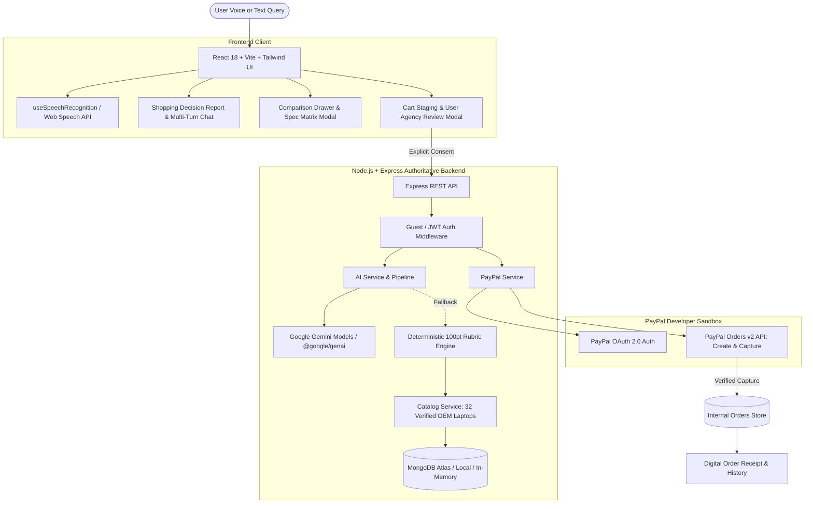

# 🧭 PayPilot — AI Shopping Decision & Checkout Agent

> **"Think smarter. Shop better. Stay in control."**  
> Developed for the **PayPal AI Hackathon 2026**

---

## 🎯 Executive Product Vision

Conventional shopping bots and AI search engines suffer from three fundamental flaws:
1. **Hallucinated Specs:** They invent RAM speeds, battery hours, or GPU models that don't exist.
2. **Pushy Sales Funnels:** They prioritize selling rather than honest trade-off analysis.
3. **Runaway Autonomy:** Unsafe agents attempt to make financial commitments without explicit human review.

**PayPilot** solves this by establishing a **high-integrity, grounded shopping and payment agent**. It couples natural language reasoning with a **mathematical 100-point deterministic ranking engine**, **Web Speech API voice dictation**, and a **server-authoritative PayPal Orders v2 checkout bridge**.

> [!IMPORTANT]
> **Strict User Agency Guarantee**: PayPilot will **never** initiate a purchase without the user's explicit, informed approval. Product specifications and authoritative prices are strictly decoupled from AI-generated text.

---

## 🌟 Key Features

### 🎙️ 1. Multi-Modal Voice & Natural Language Search
* **Web Speech API Integration:** Speak directly to the assistant with zero third-party transcription fees or latency.
* **Intelligent Query Interpretation:** Extracts target workload (`coding`, `ai-ml`, `college`, `gaming`), budget ceilings, and hardware priorities.
* **Ambiguity Clarification:** Broad queries automatically trigger guided persona cards (*Budget CS*, *Mid-Range Dev*, *High-Performance AI/ML*).

### 🤖 2. Grounded Decision Report & Multi-Turn Refinement
* **#1 Authoritative Recommendation:** Top match scored against a 5-factor mathematical rubric.
* **Side-by-Side Alternatives:** Honest, OEM-verified trade-offs (e.g. soldered RAM, heavier chassis, fan noise under compilation).
* **Multi-Turn Conversational Memory:** Refine criteria naturally (*"What about a lighter option with 16GB RAM?"*) while preserving active session constraints.
* **Model Agnostic with Zero-Config Fallback:** Powered by Google Gemini with an automatic fallback chain (`gemini-2.5-flash`, `gemini-2.0-flash`, `gemini-1.5-flash`) and a local deterministic rule engine if API keys are omitted.

### ⚖️ 3. Interactive Hardware Spec Matrix (Powered by AG Grid Community v36)
* **High-Performance AG Grid Integration:** Built for the **"Best Use of AG Grid"** ($5,000) prize track.
* **Multi-Column Spec Analysis:** Sort, pin, and filter all 32 verified laptops across CPU cores, RAM capacity, SO-DIMM modularity, dedicated GPU VRAM, open M.2 bays, real-world battery endurance, chassis weight, and dual-currency pricing (INR/USD).
* **Live Quick Search & Instant CSV Export:** Features AG Grid's client-side quick filter and one-click native CSV specification export.
* **Dual-Mode Analytical View:** Seamless tab toggle between side-by-side card difference analysis and the full AG Grid matrix.

### 🛡️ 4. 5-Stage Agentic Safety & Audit Pipeline
Users can expand the **`>_ Inspect Agent Reasoning & Safety Pipeline`** console on any decision report:
1. **Stage 1 [Decompose]:** Formal constraint extraction from unstructured natural language.
2. **Stage 2 [Deterministic Scoring]:** Rubric scoring across verified catalog records.
3. **Stage 3 [Anti-Hallucination Gate]:** Spec validation against genuine OEM hardware attributes.
4. **Stage 4 [User Agency Checkpoint]:** Order total locked and staged for explicit user sign-off.
5. **Stage 5 [PayPal Settlement Bridge]:** Cryptographic order creation and capture verification.

### 💳 5. PayPal Developer Sandbox Checkout
* **Server-Authoritative Pricing:** Client never computes or modifies order amounts.
* **PayPal Orders v2 API:** End-to-end sandbox creation and capture flow.
* **Dual-Currency Conversion:** Transparent real-time conversion between INR (catalog base) and USD (PayPal settlement).
* **Order Tracking & Digital Receipts:** View order history, status lifecycle (`PENDING_APPROVAL` → `COMPLETED`), and printable receipts.

### 🔌 6. Agent-to-Agent (A2A) Commerce API & SDKs (Powered by APIMatic)
* **High-Value APIMatic Integration:** Built for the **"Best Use of APIMatic"** ($1,000 cash) prize track.
* **OpenAPI 3.0 Standardized Specification:** Full OpenAPI 3.0 contract (`openapi.json` & `backend/docs/openapi.json`) covering all recommendation, comparison, and PayPal checkout endpoints.
* **APIMatic Multi-Language SDK Generation:** Configured with `APIMATIC-META.json` to generate production-ready client SDKs in **Python**, **TypeScript**, **Java**, **C#**, and **Go**.
* **Interactive Live API Portal:** Visit `http://localhost:5000/api/docs` (or `/api/docs` in production) to explore interactive request builders and code snippets.
* **Autonomous Agent Integration Example (Python SDK via APIMatic):**
  ```python
  from paypilot_sdk import PayPilotClient

  client = PayPilotClient(environment="sandbox")

  # 1. Autonomous AI agent submits natural language hardware goal
  decision = client.assistant.chat(
      message="Need 32GB RAM coding laptop with dedicated GPU under ₹1,20,000"
  )
  print(f"Recommended: {decision.recommendation.name} (${decision.recommendation.price_usd})")

  # 2. Programmatically stage server-authoritative PayPal order
  order = client.paypal.create_order(
      product_id=decision.recommendation.id,
      buyer_info={"name": "Procurement Bot 7", "email": "procurement@corp.internal"},
      shipping_address={"street": "123 Tech Blvd", "city": "San Jose", "state": "CA", "postal_code": "95131", "country_code": "US"}
  )
  print(f"PayPal Sandbox Order Created: {order.id}")
  ```

---

## 🏗️ Architecture Diagram



---

## 📊 Deterministic Ranking Rubric (100 Points)

Match scores are calculated mathematically on the backend — never hallucinated by an LLM:

| Category | Weight | Evaluation Criteria |
| :--- | :---: | :--- |
| **Budget Headroom** | **30 pts** | Proximity to price ceiling and financial headroom under limit. |
| **Workload Alignment** | **25 pts** | CPU core tier, dedicated NVIDIA CUDA GPU for AI/ML vs high single-core for compilers. |
| **RAM Multitasking** | **20 pts** | Minimum 8GB vs 16GB+ capacity for Docker, IDEs, and local LLMs. |
| **Portability & Endurance** | **15 pts** | Real-world battery runtime estimate and chassis weight (< 1.6 kg bonus). |
| **Modular Upgradability** | **10 pts** | User-accessible dual SO-DIMM slots and secondary M.2 SSD expansion bays. |

> *Tie-Breaker Rule: When match scores are tied within 1%, lower price INR deterministically takes precedence.*

---

## 📁 Project Structure

```
PayPilot/
├── backend/
│   ├── src/
│   │   ├── config/             # Environment, Gemini & PayPal configs
│   │   ├── controllers/        # Express handlers (assistant, paypal, order, product, auth)
│   │   ├── data/               # Curated OEM catalog (32 verified laptops)
│   │   ├── middleware/         # Error handling, sanitization & guest session auth
│   │   ├── models/             # Mongoose schemas (Product, Order, User)
│   │   ├── routes/             # REST routing (/api/assistant, /api/paypal, /api/orders, /api/products)
│   │   ├── services/
│   │   │   ├── ai.service.js         # Gemini grounding, multi-turn memory & anti-hallucination
│   │   │   ├── catalog.service.js    # Data access with zero-config in-memory fallback
│   │   │   ├── ranking.service.js    # 100-point deterministic rubric engine
│   │   │   ├── comparison.service.js # Spec divergence & matrix evaluator
│   │   │   ├── paypal.service.js     # PayPal Orders v2 create, capture & verification
│   │   │   └── order.service.js      # Order lifecycle & guest token isolation
│   │   ├── validators/         # Zod schemas for strict request payload validation
│   │   ├── app.js              # Express app setup, CORS & static file serving
│   │   └── server.js           # Server bootstrap & Mongo connector
│   └── tests/                  # Vitest suite (agent flow, grounding, PayPal, orders, ranking)
│
└── frontend/
    ├── public/
    │   └── images/products/    # High-resolution verified laptop product photographs (.webp / .jpg)
    ├── src/
    │   ├── components/
    │   │   ├── assistant/      # ShoppingDecisionReport & ClarifyingQuestionCard
    │   │   ├── cart/           # CartReviewModal (User Agency checkpoint)
    │   │   ├── checkout/       # OrderReviewModal (PayPal Sandbox flow)
    │   │   ├── comparison/     # ComparisonDrawer & ComparisonModal
    │   │   ├── layout/         # Header & Sidebar navigation
    │   │   ├── orders/         # OrdersPage & OrderDetailModal
    │   │   ├── products/       # ProductCard, ProductGrid, ProductImage & DetailModal
    │   │   └── workspace/      # SearchHero (voice input), FilterBar & PreferencesPanel
    │   ├── services/           # Typed API client connecting to backend
    │   ├── utils/              # useSpeechRecognition hook, currency formatters & session manager
    │   ├── App.jsx             # Main interactive shopping dashboard
    │   └── main.jsx
    ├── tailwind.config.js      # Fintech design tokens (Indigo, Slate, Emerald)
    └── vite.config.js          # Vite bundler configuration
```

---

## 🌐 Deploy to Render (Blueprint Specification)

PayPilot includes a complete Infrastructure-as-Code **Render Blueprint** ([`render.yaml`](file:///C:/Users/HP/Downloads/PayPilot/render.yaml)) configured for the **"Best Use of Render"** prize:
* **Backend Web Service:** Node.js Express API with auto-scaling health checks at `/api/health`.
* **Frontend Static Site:** React Vite SPA with SPA route rewrite (`/*` → `/index.html`) and direct backend environment binding.

[](https://render.com/deploy?repo=https://github.com/anuragverma025/PayPilot)

To deploy using the Render Dashboard:
1. Go to [dashboard.render.com](https://dashboard.render.com) and click **New +** → **Blueprint**.
2. Connect your repository: `https://github.com/anuragverma025/PayPilot`.
3. Render will automatically detect `render.yaml` and configure both the backend service and frontend static site.
4. Input your `AI_API_KEY` (Gemini) and optional PayPal sandbox keys in the environment prompt, then click **Apply**.

---

## 🚀 Quickstart Guide

### Prerequisites
* **Node.js**: v18+ (tested on Node v22)
* **npm**: v9+
* *(Optional)* **MongoDB**: Local MongoDB or Atlas connection. If omitted, PayPilot automatically operates in zero-config in-memory mode.

---

### 1. Backend Setup
```bash
cd backend
npm install

# Copy environment template
cp .env.example .env
```

Edit `backend/.env` with your API keys:
```env
PORT=5000
CLIENT_URL=http://localhost:5173

# Database (optional — in-memory fallback enabled if absent)
MONGODB_URI=mongodb://127.0.0.1:27017/paypilot

# Google Gemini AI (optional — deterministic rule engine fallback enabled if absent)
AI_PROVIDER=gemini
AI_API_KEY=your_gemini_api_key_here
AI_MODEL=gemini-2.5-flash

# PayPal Developer Sandbox (optional — simulated sandbox enabled if absent)
PAYPAL_CLIENT_ID=your_paypal_sandbox_client_id
PAYPAL_CLIENT_SECRET=your_paypal_sandbox_secret
PAYPAL_BASE_URL=https://api-m.sandbox.paypal.com
PAYPAL_MODE=sandbox
PAYPAL_CURRENCY=USD
```

Start the backend:
```bash
npm start          # Runs on http://localhost:5000
# or: npm run dev  # Runs with hot-reloading
```

---

### 2. Frontend Setup
In a second terminal:
```bash
cd frontend
npm install
npm run dev        # Starts Vite client on http://localhost:5173
```

Open **`http://localhost:5173`** in your browser.

---

## 🧪 Testing Suite

PayPilot includes an automated unit and integration testing suite powered by Vitest:

```bash
cd backend
npm test
```

Test coverage includes:
* **Grounded AI Pipeline:** Validates requirement decomposition and anti-hallucination checks.
* **Deterministic Scoring:** Verifies mathematical rubric scoring across edge-case budgets.
* **PayPal Orders v2:** Tests payload building, currency conversion, buyer verification, and tamper resistance.
* **Guest Isolation:** Enforces strict cryptographic guest token isolation across orders.

---

## 🔒 Security & Data Integrity

* **Zero Spec Hallucination:** 100% of product specifications reflect genuine manufacturer hardware.
* **Server-Authoritative Pricing:** The frontend cannot tamper with prices; calculations and totals are sealed on the backend.
* **No Leaked Secrets:** PayPal client secrets and Google Gemini API keys are strictly confined to the backend environment.
* **Cryptographic Capture Verification:** PayPal transactions are verified server-to-server before any order status is finalized.

---

## 📄 License

Apache License 2.0. Built with pride for the **PayPal AI Hackathon 2026**.
